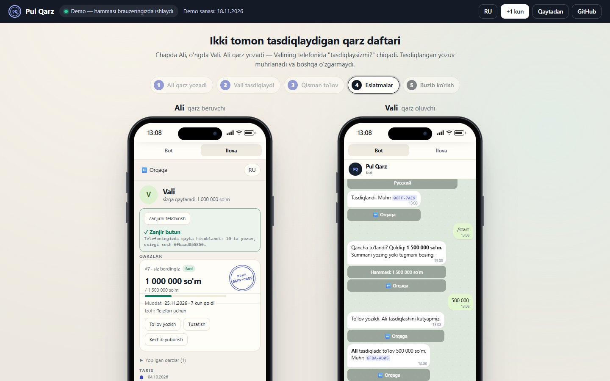
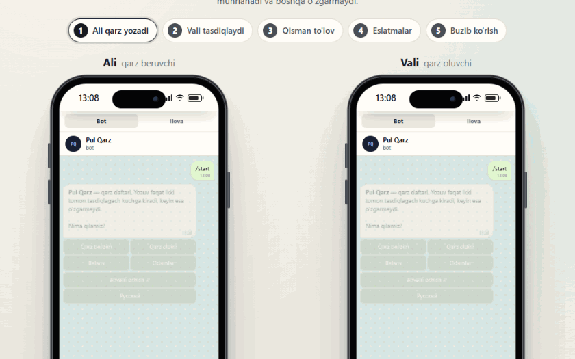
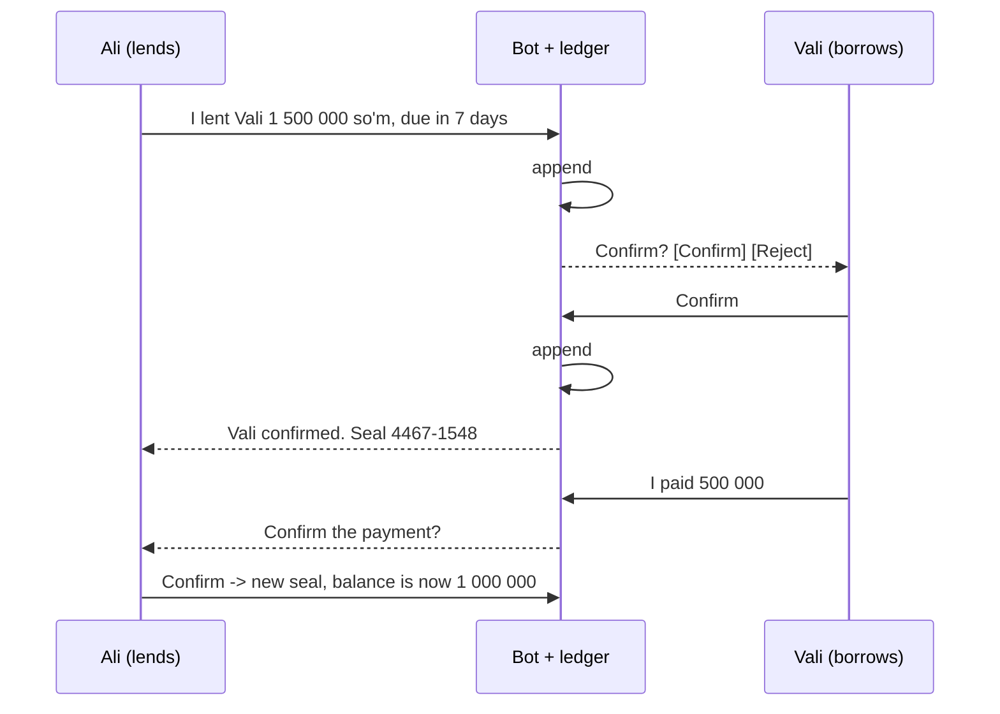
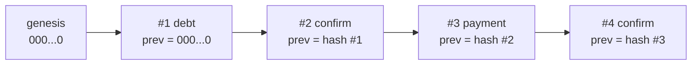

# Pul Qarz

**English** · [O'zbekcha](README.uz.md)

[](https://github.com/xoliddev/pul-qarz/actions/workflows/ci.yml)
[](https://xoliddev.github.io/pul-qarz/)
[](LICENSE)


A Telegram **bot + Mini App** that records who owes whom, and reminds both people when a debt is due.

**The twist: a debt only counts once both sides confirm it, and after that it can never be edited or deleted.**
Every record goes into an append-only **hash chain** shared by the two people. A confirmed record gets a
visible seal ("muhr") with a short hash, and anyone can check the chain on their own phone.

**[Live demo →](https://xoliddev.github.io/pul-qarz/)** two phones side by side, everything runs in your browser.



<p align="center"></p>

## Features

- **Two-sided confirmation.** "I lent" or "I borrowed": person, amount, currency (UZS or USD), due date, note.
  Nothing counts until the other person presses *Confirm*. They can also reject it, with a reason.
- **Append-only, sealed history.** Payments (partial or full), corrections (amount or date) and write-offs are new
  records that the other side must confirm as well. Old records are never changed.
- **Tamper check.** "Verify chain" re-hashes every record and shows green, or points to the exact broken link.
  The Mini App does this **on the phone itself** with a JS port of the core, so it does not have to trust the server.
- **Share link for new people.** If the other person is not in the bot yet, you get
  `t.me/<bot>?start=d_<token>`: single-use, expires after 7 days, only its SHA-256 is stored.
- **Balances.** Net per person and per currency, plus totals of "owed to me" and "I owe".
- **Reminders.** 3 days before, on the due date, then while overdue (next day, a week, a month), to both sides.
  They live in SQLite, so a restart loses nothing and each one is sent once.
- **Buttons only.** No commands apart from `/start`; every screen has a "⬅️ Orqaga" (Back) button.
  Uzbek by default, Russian with one tap.
- **Money is integers.** Amounts are stored in tiyin/cents; floats are refused even by the hashing code.

## How it works





Each record stores `prev` (the hash of the record before it) and `hash = sha256(prev + canonical_json(record))`.
Change one amount anywhere and that record's hash no longer matches, and neither does any link after it.
The ledger rules are replayed too, so even a chain rewritten with fresh hashes fails if, say, someone
"confirms" their own debt. Balances are only ever computed from the part of the chain that verifies.

## Run it on Windows in 10 minutes

You need Python 3.12 or newer from [python.org](https://www.python.org/downloads/) (tick **"Add python.exe to PATH"**).

1. **Create the bot.** In Telegram open [@BotFather](https://t.me/BotFather), send `/newbot`, choose a name and a
   username ending in `bot`. Copy the token it gives you.
2. **Get the code.** Download the ZIP and unpack it (or `git clone https://github.com/xoliddev/pul-qarz`),
   then open PowerShell in that folder.
3. **Settings.** Copy the example file and paste your token into `.env`:
   ```powershell
   Copy-Item .env.example .env
   notepad .env
   ```
4. **Install and run.**
   ```powershell
   py -m venv .venv
   .venv\Scripts\Activate.ps1
   pip install -r requirements.txt
   python -m pulqarz
   ```
   Open your bot in Telegram and press **Start**. The bot already works with buttons.

### Opening the Mini App

Telegram opens Mini Apps only over HTTPS. The easiest free way on your own computer is a Cloudflare quick tunnel:

```powershell
winget install --id Cloudflare.cloudflared
cloudflared tunnel --url http://localhost:8080
```

It prints an address like `https://something.trycloudflare.com`. Put it into `.env` with `/webapp/` at the end,
then restart the bot:

```
WEBAPP_URL=https://something.trycloudflare.com/webapp/
```

The bot sets its menu button to the Mini App by itself, and the main menu shows an "Ilovani ochish" button.
On a server, set `WEBAPP_URL` to your own HTTPS domain instead.

### Or with Docker

```powershell
Copy-Item .env.example .env   # then put your token in .env
docker compose up -d --build
```

The image runs as a non-root user with a read-only filesystem; the database is kept in the `pulqarz-data` volume.

## Settings (`.env`)

| Variable | Default | What it does |
|---|---|---|
| `BOT_TOKEN` | — (required) | Token from @BotFather |
| `WEBAPP_URL` | empty | Public HTTPS URL of the Mini App, ending in `/webapp/` |
| `DB_PATH` | `data/pulqarz.db` | SQLite file (WAL mode) |
| `HOST` / `PORT` | `0.0.0.0` / `8080` | Web server for the Mini App and its API |
| `INITDATA_MAX_AGE` | `3600` | Mini App login data older than this (seconds) is refused |
| `INVITE_DAYS` | `7` | Share links expire after this many days |
| `RATE_PER_MINUTE` | `30` | Actions per user per minute (bot and API) |
| `REMINDER_INTERVAL` | `60` | How often the reminder loop runs (seconds) |
| `LOG_LEVEL` | `INFO` | Python logging level |

## Security

- **Mini App auth:** every API call carries Telegram `initData`; the server checks its HMAC-SHA256 signature with the
  bot token and refuses data older than `INITDATA_MAX_AGE` (or dated in the future).
- **Scoped queries:** every read and write goes through the chain of *exactly two people*, one of them the caller.
  A third person can neither see nor confirm anything. Contacts can only be added through a share link.
- **Single-use links:** `secrets.token_urlsafe(16)`, stored only as SHA-256, claimed atomically, expire after 7 days,
  and cannot be used by their creator.
- **Never trust buttons:** callback data is parsed and type-checked, unknown values get "this button is stale", and the
  service re-checks every permission. The ledger refuses confirming your own proposal.
- **Append-only storage:** SQLite triggers refuse `UPDATE` and `DELETE` on ledger rows; any tampering behind the
  app's back is caught by the chain check, and a broken chain accepts no new records.
- **Input limits:** names up to 40 characters, notes and reasons up to 200, amounts parsed as integers, request bodies
  up to 16 KB, dates within 10 years. Parameterised SQL only.
- **Rate limits** per user for the bot and the API; strict CSP and `nosniff` headers on the Mini App.
- **Config from env only;** `.env.example` holds placeholders. The Docker container runs as a non-root user.

## Project layout

```
pulqarz/core/      pure logic, no I/O: canonical JSON, hash chain, balances, reminders, money
pulqarz/           service (use cases + authorization), SQLite, initData check, reminder loop, aiohttp API
pulqarz/bot/       aiogram 3 handlers and screens (buttons only)
shared/            JS port of the core + shared locale files (uz, ru) + test vectors used by both test suites
webapp/            the Mini App: plain HTML, CSS and JS, no build step
demo/              the GitHub Pages demo: two phones, a simulated bot and an in-browser backend
tests/ js-tests/   pytest (core, service, bot end-to-end, API) and node --test (parity, demo)
```

## Tests

```powershell
pip install -r requirements-dev.txt
ruff check .
pytest                    # core vectors, service, API, the bot end-to-end with a mocked Bot API
node --test js-tests/     # the JS port against the same vectors, and the demo on 30+ different dates
npm i --no-save playwright; $env:PW_CHANNEL="chrome"; node scripts/e2e.mjs   # demo in a real browser
```

`shared/test_vectors.json` holds canonical JSON, hashes, balances and reminder dates. pytest checks the Python core
against it and `node --test` checks the JS port, so the browser can verify chains exactly like the server.

## License

[MIT](LICENSE) © 2026 xoliddev
