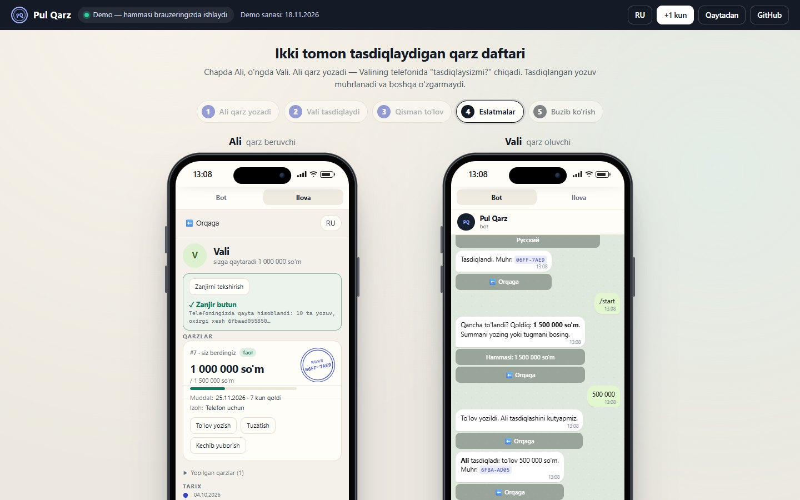
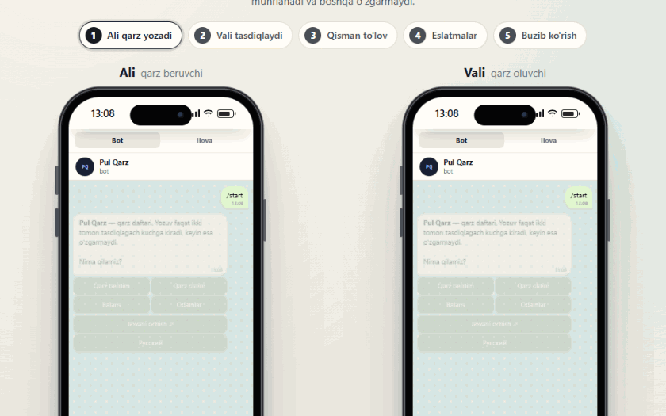
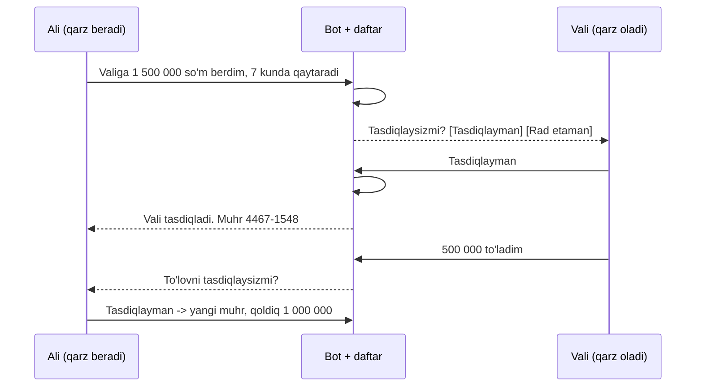
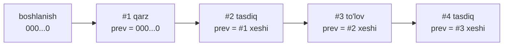

# Pul Qarz

[English](README.md) · **O'zbekcha**

[](https://github.com/xoliddev/pul-qarz/actions/workflows/ci.yml)
[](https://xoliddev.github.io/pul-qarz/)
[](LICENSE)


Kim kimga qancha qarzligini yozib boradigan va muddati kelganda ikkala tomonga eslatadigan Telegram **bot + Mini App**.

**Asosiy farqi: qarz faqat ikki tomon ham tasdiqlagandan keyin kuchga kiradi, keyin esa uni o'zgartirib ham,
o'chirib ham bo'lmaydi.** Har bir yozuv ikki kishi uchun umumiy **xesh-zanjirga** qo'shiladi. Tasdiqlangan
yozuvga qisqa xeshli "muhr" bosiladi, zanjirni esa har kim o'z telefonida tekshira oladi.

**[Jonli demo →](https://xoliddev.github.io/pul-qarz/)** yonma-yon ikki telefon, hammasi brauzeringizda ishlaydi.



<p align="center"></p>

## Imkoniyatlar

- **Ikki tomonlama tasdiq.** "Qarz berdim" yoki "Qarz oldim": kim, summa, valyuta (so'm yoki dollar), muddat, izoh.
  Ikkinchi odam *Tasdiqlayman* demaguncha hech narsa hisoblanmaydi. U sababini aytib rad etishi ham mumkin.
- **Faqat qo'shiladigan, muhrlangan tarix.** To'lov (qisman yoki to'liq), tuzatish (summa yoki muddat) va kechib
  yuborish ham yangi yozuv bo'lib tushadi va ularni ham ikkinchi tomon tasdiqlaydi. Eski yozuv hech qachon o'zgarmaydi.
- **Buzilishni tekshirish.** "Zanjirni tekshirish" har bir yozuvni qayta xeshlaydi: hammasi joyida bo'lsa yashil,
  aks holda aynan qaysi yozuvda uzilganini ko'rsatadi. Mini App buni **telefonning o'zida** qiladi, serverga ishonmaydi.
- **Yangi odam uchun havola.** Sherigingiz hali botda bo'lmasa, `t.me/<bot>?start=d_<token>` havolasi beriladi:
  bir marta ishlaydi, 7 kunda eskiradi, bazada faqat uning SHA-256 xeshi saqlanadi.
- **Balans.** Har bir odam va har bir valyuta bo'yicha sof qoldiq, hamda "menga qaytariladi" va "men qaytaraman" jami.
- **Eslatmalar.** Muddatdan 3 kun oldin, muddat kuni, keyin muddat o'tganda (ertasi, bir haftadan, bir oydan keyin),
  ikkala tomonga. Ular SQLite'da saqlanadi: bot qayta ishga tushsa ham yo'qolmaydi va har biri bir marta yuboriladi.
- **Faqat tugmalar.** `/start` dan boshqa buyruq yo'q, har bir ekranda "⬅️ Orqaga" tugmasi bor.
  Til odatda o'zbekcha, bir bosishda ruschaga o'tadi.
- **Pul faqat butun son.** Summalar tiyin va sentlarda saqlanadi; kasr son (float) xeshlash kodida ham qabul qilinmaydi.

## Qanday ishlaydi





Har bir yozuvda `prev` (oldingi yozuvning xeshi) va `hash = sha256(prev + kanonik_json(yozuv))` bor.
Qayerdadir bitta summani o'zgartirsangiz, o'sha yozuvning xeshi mos kelmay qoladi. Daftar qoidalari ham qayta
tekshiriladi: hatto xeshlarni qaytadan hisoblab chiqqan odam ham, masalan, o'z qarzini o'zi "tasdiqlasa", ushlanadi.
Balans faqat zanjirning tekshiruvdan o'tgan qismidan hisoblanadi.

## Windows'da 10 daqiqada ishga tushirish

[python.org](https://www.python.org/downloads/) dan Python 3.12 yoki yangisini o'rnating
(**"Add python.exe to PATH"** belgisini qo'ying).

1. **Bot yarating.** Telegram'da [@BotFather](https://t.me/BotFather) ni oching, `/newbot` yuboring, nom va
   oxiri `bot` bilan tugaydigan username tanlang. Bergan tokenni nusxalab oling.
2. **Kodni oling.** ZIP'ni yuklab, oching (yoki `git clone https://github.com/xoliddev/pul-qarz`).
   O'sha papkada PowerShell'ni oching.
3. **Sozlamalar.** Namuna faylni nusxalang va tokenni `.env` ga qo'ying:
   ```powershell
   Copy-Item .env.example .env
   notepad .env
   ```
4. **O'rnatib, ishga tushiring.**
   ```powershell
   py -m venv .venv
   .venv\Scripts\Activate.ps1
   pip install -r requirements.txt
   python -m pulqarz
   ```
   Telegram'da botingizni ochib **Start** ni bosing. Bot tugmalar bilan darhol ishlaydi.

### Mini App'ni ochish

Telegram Mini App'ni faqat HTTPS orqali ochadi. O'z kompyuteringizda eng oson bepul yo'l — Cloudflare tunneli:

```powershell
winget install --id Cloudflare.cloudflared
cloudflared tunnel --url http://localhost:8080
```

U `https://nimadir.trycloudflare.com` kabi manzil chiqaradi. Uni oxiriga `/webapp/` qo'shib `.env` ga yozing va
botni qayta ishga tushiring:

```
WEBAPP_URL=https://nimadir.trycloudflare.com/webapp/
```

Bot menyu tugmasini o'zi Mini App'ga ulaydi, bosh menyuda esa "Ilovani ochish" tugmasi chiqadi.
Serverda `WEBAPP_URL` ga o'z HTTPS domeningizni yozasiz.

### Yoki Docker bilan

```powershell
Copy-Item .env.example .env   # keyin .env ga tokenni yozing
docker compose up -d --build
```

Konteyner root bo'lmagan foydalanuvchi bilan, faqat o'qiladigan fayl tizimida ishlaydi; baza `pulqarz-data` hajmida.

## Sozlamalar (`.env`)

| O'zgaruvchi | Odatiy qiymat | Vazifasi |
|---|---|---|
| `BOT_TOKEN` | — (majburiy) | @BotFather bergan token |
| `WEBAPP_URL` | bo'sh | Mini App'ning HTTPS manzili, oxiri `/webapp/` |
| `DB_PATH` | `data/pulqarz.db` | SQLite fayli (WAL rejimi) |
| `HOST` / `PORT` | `0.0.0.0` / `8080` | Mini App va uning API'si uchun veb-server |
| `INITDATA_MAX_AGE` | `3600` | Bundan eski (soniya) Mini App kirish ma'lumoti rad etiladi |
| `INVITE_DAYS` | `7` | Havola necha kundan keyin eskiradi |
| `RATE_PER_MINUTE` | `30` | Bir foydalanuvchining daqiqasiga amallari (bot va API) |
| `REMINDER_INTERVAL` | `60` | Eslatmalar qancha vaqtda bir tekshiriladi (soniya) |
| `LOG_LEVEL` | `INFO` | Log darajasi |

## Xavfsizlik

- **Mini App kirishi:** har bir API so'rovida Telegram `initData` bor; server uning HMAC-SHA256 imzosini bot tokeni bilan
  tekshiradi va `INITDATA_MAX_AGE` dan eski (yoki kelajak sanali) ma'lumotni rad etadi.
- **Faqat o'z zanjiri:** har bir o'qish va yozish *aynan ikki kishining* zanjiri orqali o'tadi, ulardan biri so'rovchining
  o'zi. Uchinchi odam hech narsani ko'ra olmaydi va tasdiqlay olmaydi. Yangi sherik faqat havola orqali qo'shiladi.
- **Bir martalik havola:** `secrets.token_urlsafe(16)`, bazada faqat SHA-256, bir marta ishlatiladi, 7 kunda eskiradi,
  yaratgan odamning o'zi ocha olmaydi.
- **Tugmaga ishonilmaydi:** callback ma'lumoti tekshiriladi, notanish qiymatga "bu tugma eskirgan" deyiladi, xizmat har
  bir ruxsatni qayta tekshiradi. O'z taklifingizni o'zingiz tasdiqlay olmaysiz.
- **Faqat qo'shiladigan baza:** SQLite triggerlari daftar yozuvlarini `UPDATE` va `DELETE` qilishga yo'l qo'ymaydi;
  ilovani chetlab o'tgan o'zgarishni zanjir tekshiruvi ushlaydi, buzilgan zanjirga yangi yozuv qo'shilmaydi.
- **Kiritish chegaralari:** ism 40 belgigacha, izoh va sabab 200 tagacha, summa butun son, so'rov tanasi 16 KB gacha,
  sana 10 yil ichida. SQL faqat parametrlar bilan.
- **Tezlik cheklovi** har bir foydalanuvchiga; Mini App'da qat'iy CSP va `nosniff` sarlavhalari.
- **Sozlamalar faqat env'dan;** `.env.example` da faqat namuna qiymatlar. Docker konteyneri root'siz ishlaydi.

## Papkalar

```
pulqarz/core/      sof mantiq, I/O yo'q: kanonik JSON, xesh-zanjir, balans, eslatmalar, pul
pulqarz/           servis (amallar va ruxsatlar), SQLite, initData tekshiruvi, eslatma sikli, aiohttp API
pulqarz/bot/       aiogram 3 handlerlari va ekranlari (faqat tugmalar)
shared/            yadroning JS nusxasi + umumiy til fayllari (uz, ru) + ikkala test to'plami uchun test vektorlari
webapp/            Mini App: oddiy HTML, CSS va JS, yig'ish (build) bosqichi yo'q
demo/              GitHub Pages demosi: ikki telefon, simulyatsiya qilingan bot va brauzer ichidagi backend
tests/ js-tests/   pytest (yadro, servis, botning to'liq oqimi, API) va node --test (moslik, demo)
```

## Testlar

```powershell
pip install -r requirements-dev.txt
ruff check .
pytest                    # yadro vektorlari, servis, API, soxta Bot API bilan botning to'liq oqimi
node --test js-tests/     # JS nusxasi o'sha vektorlar bilan, demo esa 30 dan ortiq turli sanada
npm i --no-save playwright; $env:PW_CHANNEL="chrome"; node scripts/e2e.mjs   # demo haqiqiy brauzerda
```

## Litsenziya

[MIT](LICENSE) © 2026 xoliddev
